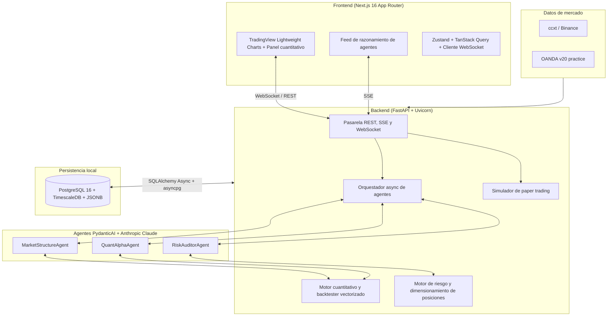

# ⚡ QuantAgentic Terminal — Plataforma de trading cuantitativo y algorítmico impulsada por IA (MVP)

> **Terminal personal de investigación cuantitativa multi-activo**, potenciado por agentes de IA, backtesting vectorizado determinista y desarrollo dirigido por especificaciones (SDD).
>
> **Alcance del MVP:** BTC/USDT (cripto) • EUR/USD y XAU/USD (Forex) • NAS100 (índices) — en marcos temporales de 15m, 1H, 4H y 1D, **solo en paper trading**.

📜 **La fuente única de verdad del proyecto es [`specs/`](specs/):**

- [`specs/mission.md`](specs/mission.md): misión, público objetivo, alcance y principios no negociables.
- [`specs/tech-stack.md`](specs/tech-stack.md): decisiones tecnológicas cerradas.
- [`specs/roadmap.md`](specs/roadmap.md): orden de implementación en fases pequeñas.

Si este README contradice a `specs/`, prevalece `specs/`.

---

## 🏗 Visión y arquitectura del sistema

**QuantAgentic Terminal** es una herramienta personal para un trader-desarrollador. En lugar de depender de alertas basadas en indicadores estáticos, la plataforma emplea **agentes de IA** especializados que analizan datos de mercado en varios marcos temporales, interpretan la estructura y el régimen del mercado y formulan **propuestas de operación** (`TradeSignalSchema`) estrictamente tipadas. Antes de llegar al usuario, cada propuesta pasa por controles de riesgo deterministas.

El objetivo del MVP es responder con rigor a una pregunta: *¿producen los agentes señales con valor esperado positivo, y puedo auditar por qué las produjeron?*



> El `MacroSentimentAgent` (análisis macro y de sentimiento) queda fuera del MVP; está previsto para después.

---

## 🛠 Stack tecnológico

Resumen. El detalle completo está en [`specs/tech-stack.md`](specs/tech-stack.md).

| Capa | Tecnología | Propósito |
| :--- | :--- | :--- |
| **Frontend** | **Next.js 16.4 (App Router)**, React 19.3, TypeScript 5, Tailwind CSS 4, Node 22+ con npm | Interfaz de terminal reactiva y densa. |
| **Gráficos e interfaz** | `lightweight-charts` (TradingView), shadcn/ui, Lucide | Velas OHLCV, zonas de entrada, SL/TP, cajas FVG y curvas de capital. |
| **Estado y tiempo real** | Zustand, TanStack Query, WebSocket, SSE | Estado del terminal, caché de servidor y streaming. |
| **Contratos** | Pydantic v2 → OpenAPI → `openapi-typescript` | Los tipos TS se **generan**; no se escriben a mano. |
| **API del backend** | **FastAPI**, **Uvicorn**, Pydantic v2, Python 3.12 con **uv** | Endpoints async, validación estricta, SSE y WebSocket. |
| **Capa de agentes** | **PydanticAI** + **Anthropic Claude** (`claude-sonnet-5-5` por defecto) | Salidas estructuradas y herramientas deterministas; orquestador async propio. |
| **Núcleo cuantitativo** | `polars`, `numpy`, `scipy`, `statsmodels`, **backtester vectorizado propio** | ATR, estructura de mercado, Z-score, Hurst, ADF y métricas de backtest reproducibles. |
| **Datos de mercado** | `ccxt` (BTC/USDT) y **OANDA v20 practice** (EUR/USD, XAU/USD, NAS100_USD) | Ingesta unificada de OHLCV normalizado en UTC. |
| **Base de datos** | **PostgreSQL 16+** local con **TimescaleDB**, SQLAlchemy 2.0 async, Alembic | Hypertable OHLCV, señales, estrategias y auditoría de agentes en JSONB. |
| **Calidad** | ruff, mypy, pytest + hypothesis, ESLint, Vitest, Playwright, GitHub Actions | Tests de determinismo, propiedades de riesgo y E2E. |

---

## 📜 Contratos SDD (desarrollo dirigido por especificaciones)

Todas las funcionalidades se desarrollan con el enfoque **«esquemas primero»**: no se implementa ningún endpoint, herramienta de agente ni componente de UI sin haber definido antes su contrato Pydantic. Los tipos TypeScript se generan a partir de ese contrato.

### Dominio y esquema de base de datos (`quant_terminal_db`)

| Tabla | Contenido |
| :--- | :--- |
| `instruments` | Registro normalizado de activos: símbolo, clase de activo (`CRYPTO`, `FOREX`, `INDEX`), tamaño del tick, tamaño del lote y horario de sesión. |
| `ohlcv_bars` | **Hypertable de TimescaleDB**: `instrument_id`, `timeframe`, `ts`, `open`, `high`, `low`, `close`, `volume`. Clave única `(instrument_id, timeframe, ts)`. |
| `agent_analyses` | Registro de auditoría **de solo inserción** de cada ejecución de agente: `id`, `instrument_id`, `timeframe`, régimen, puntuación de confianza, traza de razonamiento (JSONB), modelo, tokens, coste, latencia y `created_at`. |
| `strategies` | Reglas algorítmicas parametrizadas: `id`, nombre, clase de activo, parámetros (JSONB), Sharpe, máximo drawdown y tasa de aciertos. |
| `trade_signals` | Señales validadas por el motor de riesgo: `id`, `strategy_id`, `analysis_id`, dirección (`LONG`/`SHORT`), entrada, SL, TP, R:R, tamaño de posición y estado (`PENDING`, `APPROVED`, `REJECTED`, `EXECUTED`). |

### Orquestación multiagente

Pipeline async secuencial: **Structure → Quant → veto determinista → RiskAuditor**. Cada agente devuelve un esquema Pydantic estricto.

1. **`MarketStructureAgent`**
   - *Entradas:* OHLCV en 15m, 1H, 4H y 1D, ATR y perfil de volumen.
   - *Salidas:* sesgo de tendencia, BOS, CHoCH, FVG y niveles clave de liquidez. La detección la hacen herramientas deterministas; el LLM sintetiza el resultado.
2. **`QuantAlphaAgent`**
   - *Entradas:* rendimientos logarítmicos, volatilidad móvil (σ), exponente de Hurst (H) y test ADF.
   - *Salidas:* régimen (`MEAN_REVERTING`, `TRENDING`, `HIGH_VOLATILITY_NOISE`) y Z-scores extremos. La fracción de Kelly (f\*) la calcula el código, no el LLM.
3. **Veto determinista (código):** rechaza automáticamente cualquier propuesta con **R:R < 1,8** o que haga superar los límites de riesgo o drawdown de la cartera.
4. **`RiskAuditorAgent`**
   - *Entradas:* propuesta, saldo de la cuenta, exposición abierta y matriz de correlación.
   - *Salidas:* veredicto final `APPROVE`/`VETO` con su justificación.

### API REST, SSE y WebSocket (`/api/v1`)

| Método | Endpoint | Descripción | Solicitud → respuesta |
| :--- | :--- | :--- | :--- |
| `GET` | `/market/ohlcv` | Velas históricas normalizadas | `symbol`, `tf`, `limit` → `List[CandleSchema]` |
| `POST` | `/agents/analyze` | Análisis multiagente | `AnalyzeRequest` → stream SSE + `AgentReportSchema` |
| `POST` | `/quant/backtest` | Simulación vectorizada de una estrategia | `BacktestConfig` → `BacktestMetricsSchema` |
| `GET` | `/signals/active` | Señales aprobadas por el sistema de riesgo | `asset_class` → `List[TradeSignalSchema]` |
| `POST` | `/signals/{id}/execute` | Ejecución **simulada** (paper trading) | `ExecutionConfirm` → `OrderReceiptSchema` |
| `WS` | `/ws/stream/{symbol}` | Ticks y alertas en tiempo real | `TickUpdateEvent` \| `SignalAlertEvent` |

### Esquema canónico `TradeSignalSchema`

```json
{
  "signal_id": "uuid-v4",
  "symbol": "XAUUSD",
  "asset_class": "FOREX",
  "timeframe": "1H",
  "regime": "TRENDING_BULLISH",
  "direction": "LONG",
  "entry_zone": [2642.50, 2645.00],
  "stop_loss": 2631.00,
  "take_profit_targets": [2665.00, 2682.00],
  "metrics": {
    "risk_reward_ratio": 2.45,
    "win_probability_est": 0.61,
    "expected_value_r": 1.10,
    "recommended_risk_pct": 1.0,
    "calculated_position_size": 0.85
  },
  "agent_consensus": {
    "technical_score": 88,
    "quant_score": 82,
    "risk_verdict": "APPROVED"
  }
}
```

---

## 📂 Estructura de directorios

> Las carpetas marcadas con *(fase N)* aún no existen; se crean en esa fase del [roadmap](specs/roadmap.md).

```
trading_desk/
├── specs/                          # SDD: fuente única de verdad
│   ├── mission.md · tech-stack.md · roadmap.md
│   └── YYYY-MM-DD-<funcionalidad>/ # plan.md, requirements.md, validation.md por funcionalidad
│
├── backend/                        # FastAPI + motor cuantitativo + agentes (Python 3.12, uv)
│   ├── app/
│   │   ├── api/v1/                 # Routers REST, SSE y WebSocket
│   │   ├── core/                   # Config (pydantic-settings), sesión de BD, logging (structlog)
│   │   ├── models/                 # Modelos ORM SQLAlchemy 2.0
│   │   ├── schemas/                # DTOs Pydantic v2 (contratos)
│   │   ├── market_data/            # Adaptadores ccxt (Binance), OANDA v20 y fake; registro
│   │   ├── repositories/           # Acceso a datos: instrumentos y velas (upsert idempotente)
│   │   ├── services/               # Servicios de aplicación (ingesta de velas)
│   │   ├── cli/                    # CLI de ingesta: `python -m app.cli.ingest`
│   │   ├── quant/                  # (fase 2) Indicadores, Hurst, Z-score, backtester
│   │   ├── risk/                   # (fase 2) Position sizing, Kelly, guardas de drawdown
│   │   ├── agents/                 # (fase 3) Agentes PydanticAI y orquestador
│   │   ├── paper/                  # (fase 4) Simulador de paper trading
│   │   └── main.py                 # App FastAPI
│   ├── alembic/                    # Migraciones
│   ├── scripts/setup_db.sh         # Rol, bases de datos y extensiones (idempotente)
│   ├── scripts/export_openapi.py   # Escribe openapi.json (contrato versionado)
│   ├── openapi.json                # Contrato OpenAPI versionado (la CI comprueba que esté al día)
│   ├── tests/                      # pytest (marcador `db` para tests con BD real)
│   ├── .env.example
│   ├── pyproject.toml
│   └── uv.lock
│
├── frontend/                       # Next.js 16 (App Router, Node 22+)
│   ├── app/                        # Rutas (fase 4: /desk, /backtest, /agents, /journal)
│   ├── components/ hooks/ store/   # (fase 4)
│   ├── types/api.ts                # GENERADO con openapi-typescript (no editar; `npm run gen:api`)
│   ├── AGENTS.md                   # Avisos de Next 16 para agentes (gestionado por next dev)
│   ├── vitest.config.mts
│   └── package.json
│
├── .github/workflows/ci.yml        # CI: lint, typecheck, tests y build
└── README.md
```

---

## 🚀 Configuración del entorno de desarrollo local

### Requisitos previos

- [**uv**](https://docs.astral.sh/uv/) (instala y fija Python 3.12 por su cuenta)
- Node.js **22+** con **npm**
- **PostgreSQL 16** con **TimescaleDB 2.x**, en local en el puerto **5432**
- *(fase 1)* Una cuenta **OANDA practice** · *(fase 3)* una clave de API de **Anthropic**

### 1. PostgreSQL 16 + TimescaleDB (Ubuntu 22.04)

Instala `postgresql-16` desde el repositorio apt oficial de PostgreSQL (PGDG) y `timescaledb-2-postgresql-16` desde el de Timescale. Después, configura y reinicia **solo** el clúster 16:

```bash
sudo timescaledb-tune --yes \
  --pg-config /usr/lib/postgresql/16/bin/pg_config \
  --conf-path /etc/postgresql/16/main/postgresql.conf
sudo systemctl restart postgresql@16-main
pg_lsclusters            # 16/main online en el puerto 5432
```

Crea el rol, las bases de datos (`quant_terminal_db` y `quant_terminal_test`) y las extensiones. El script es idempotente:

```bash
sudo -u postgres bash < backend/scripts/setup_db.sh     # PGPORT=5432 por defecto
```

### 2. Backend (FastAPI + Uvicorn)

```bash
cd backend
uv sync
cp .env.example .env
uv run alembic upgrade head
uv run uvicorn app.main:app --reload             # http://localhost:8000/docs
curl localhost:8000/api/v1/health                # 200 {"status":"ok",...} · 503 si la BD falla
```

### 3. Ingesta de datos de mercado

Con las migraciones aplicadas (incluyen el seed de `instruments`), la CLI descarga velas cerradas, normalizadas en UTC, y las guarda de forma idempotente:

```bash
cd backend
uv run python -m app.cli.ingest backfill    --symbol BTC/USDT --tf 1h [--since 2024-01-01]
uv run python -m app.cli.ingest incremental --symbol BTC/USDT --tf 1h
uv run python -m app.cli.ingest incremental --all
curl "localhost:8000/api/v1/market/ohlcv?symbol=BTC%2FUSDT&tf=1h&limit=500"
```

- `backfill` descarga el horizonte por defecto (o desde `--since`); `incremental` parte de la última vela guardada.
- BTC/USDT usa Binance (datos públicos). EUR/USD, XAU/USD y NAS100 requieren `OANDA_API_TOKEN` y `OANDA_ACCOUNT_ID` en `.env`; la validación contra OANDA real sigue pendiente (aún no hay cuenta practice).
- Tras cambiar esquemas o endpoints: `cd backend && uv run python scripts/export_openapi.py` y `cd frontend && npm run gen:api`; versiona `openapi.json` y `types/api.ts`.

### 4. Frontend (Next.js)

```bash
cd frontend
npm install
cp .env.local.example .env.local
npm run dev                                      # http://localhost:3000
```

> ⚠️ Next.js 16 introduce cambios incompatibles con versiones anteriores. Antes de escribir código de frontend, consulta `frontend/node_modules/next/dist/docs/` (véase [`frontend/AGENTS.md`](frontend/AGENTS.md)).

### 5. Calidad y tests

```bash
# Backend
cd backend
uv run ruff check . && uv run ruff format --check .
uv run mypy app                                  # strict
uv run pytest                                    # todos (requiere la BD de tests migrada a head)
uv run pytest -m "not db"                        # sin base de datos

# Frontend
cd frontend
npm run gen:api                                  # regenera types/api.ts desde backend/openapi.json
npm run lint && npm run typecheck && npm test && npm run build
```

La CI ([`.github/workflows/ci.yml`](.github/workflows/ci.yml)) ejecuta todo lo anterior en cada PR contra un *service* `timescale/timescaledb:latest-pg16`. Además comprueba que `backend/openapi.json` y `frontend/types/api.ts` están regenerados (falla si `git diff` no está vacío). Playwright (E2E) llegará en la fase 4.

---

## 🛡 Salvaguardas de riesgo y ejecución

**Regla de oro:** un LLM nunca calcula el tamaño de la posición ni puede saltarse las reglas de gestión de riesgo.

- **Cálculos estrictamente deterministas:** los LLM se limitan a sintetizar patrones, interpretar el régimen de mercado y formular hipótesis. El tamaño de posición, la fracción de Kelly, el Sharpe, el drawdown y el R:R se calculan con Python puro (numpy, scipy, polars).
- **Veto determinista:** cualquier propuesta con R:R < 1,8 se rechaza en código, antes de que la vea el `RiskAuditorAgent`.
- **Circuit breakers:**
  - El riesgo máximo por operación es el **1,0 %** del capital (configurable).
  - La pérdida máxima diaria es el **3,0 %**. Al alcanzarla, la ejecución de señales se desactiva durante el resto del día.
- **Solo paper trading en el MVP:** no hay conexión con brokers para ejecutar órdenes reales. La ejecución con capital real, siempre con confirmación humana obligatoria (HITL), queda para después del MVP.
- **Auditabilidad:** cada análisis de agente se guarda de forma inmutable en `agent_analyses`.

---

## 🗺 Roadmap

El orden de implementación, en pasos pequeños con criterio de "hecho", está en [`specs/roadmap.md`](specs/roadmap.md). A grandes rasgos:

0. Cimientos del repositorio: monorepo, tooling, CI y base de datos.
1. Datos y esquemas: modelos, Timescale y adaptadores ccxt/OANDA.
2. Motor cuantitativo y núcleo de riesgo determinista.
3. Orquestación multiagente con PydanticAI y Claude.
4. Terminal UI en Next.js: gráfico, overlays, feed de agentes, blotter y journal.
